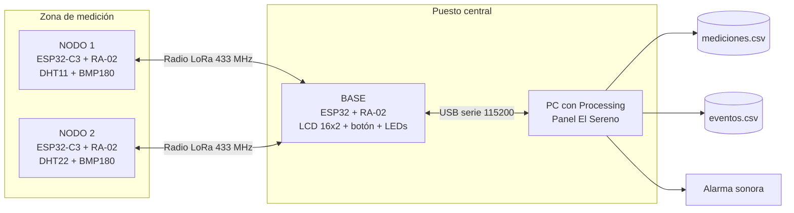
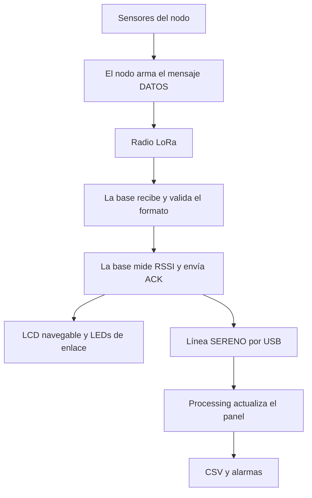
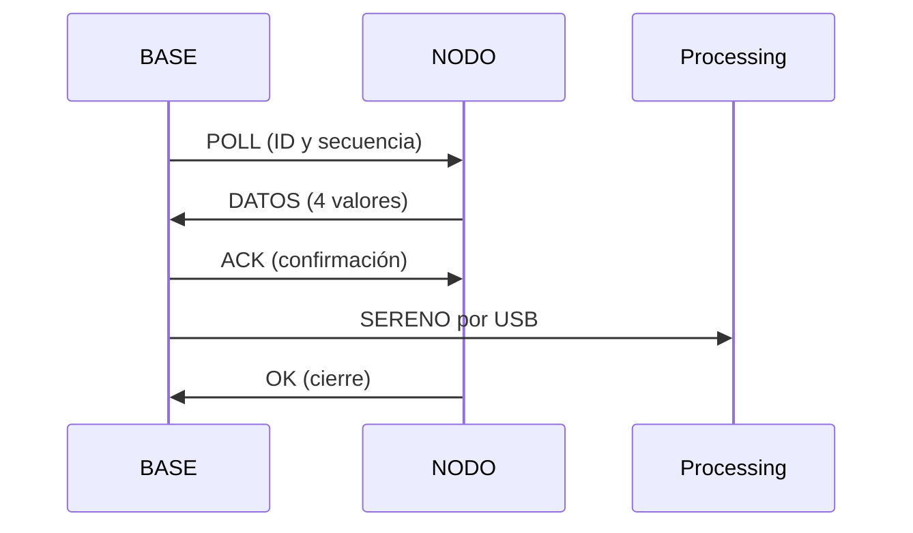
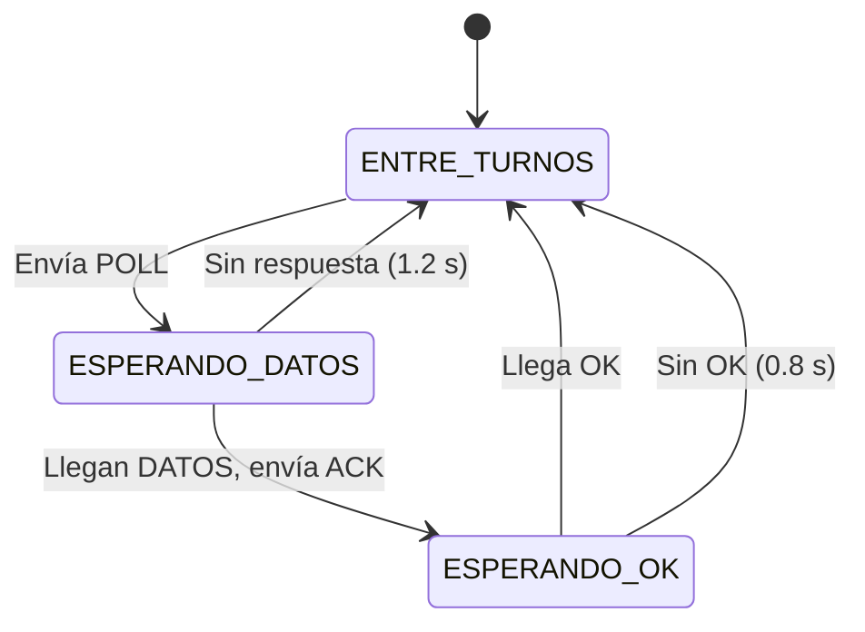

# El Sereno V4.1

**Sistema de monitoreo ambiental inalámbrico** para vigilar **frío (heladas) y humedad alta** en dos puntos distintos, con alarmas, registro histórico y un panel de control en la computadora.

> En una frase: dos estaciones con sensores miden temperatura, humedad y presión; mandan los datos por radio a una base; la base muestra las mediciones en un LCD navegable con un botón y se conecta por USB a una PC que las guarda y avisa cuando hay riesgo de helada o humedad excesiva.

---

## Índice

1. [¿Qué problema resuelve?](#1-qué-problema-resuelve)
2. [Vista general](#2-vista-general)
3. [Hardware](#3-hardware)
4. [Esquema físico (layout)](#4-esquema-físico-layout)
5. [Cómo funciona paso a paso](#5-cómo-funciona-paso-a-paso)
6. [Protocolo de comunicación](#6-protocolo-de-comunicación)
7. [Alarmas](#7-alarmas)
8. [El panel de la PC](#8-el-panel-de-la-pc)
9. [Archivos que genera](#9-archivos-que-genera)
10. [Estructura del repositorio](#10-estructura-del-repositorio)
11. [Cómo compilar y poner en marcha](#11-cómo-compilar-y-poner-en-marcha)
12. [Parámetros técnicos](#12-parámetros-técnicos)
13. [Limitaciones y posibles mejoras](#13-limitaciones-y-posibles-mejoras)
14. [Cambios de la V4.1](#14-cambios-de-la-v41)

---

## 1. ¿Qué problema resuelve?

Medir el clima en lugares alejados de la computadora (un campo, un invernadero, un patio) sin tender cables. El sistema:

- **Mide** temperatura, humedad relativa y presión atmosférica en **2 puntos**.
- **Transmite** los datos por radio LoRa, sin Wi-Fi ni internet.
- **Avisa** cuando la temperatura baja de un umbral (riesgo de helada) o la humedad supera un límite.
- **Acumula** cuánto «frío» sufrió cada punto a lo largo del tiempo (°C·min).
- **Guarda** las mediciones y eventos en archivos CSV.
- **Muestra** un resumen, cada nodo y el diagnóstico LoRa en el LCD de la base, sin necesitar una computadora para consultarlos.

---

## 2. Vista general

El sistema tiene **tres partes**:

| Parte | Qué es | Qué hace |
|---|---|---|
| **Nodo 1 y Nodo 2** | Placas con sensores a pie de campo | Miden y responden cuando la base les pregunta |
| **Base** | Placa central con pantalla LCD, botón y dos LEDs | Pregunta a los nodos por turnos, permite navegar entre pantallas y reenvía los datos a la PC |
| **Panel en la PC** | Programa hecho en Processing | Muestra datos, configura límites, suena la alarma y guarda el historial |

### Diagrama funcional



### Flujo de los datos



---

## 3. Hardware

### Nodos (x2)

| Componente | Función |
|---|---|
| ESP32-C3 SuperMini | Microcontrolador |
| Módulo LoRa RA-02 (SX1278) | Radio de 433 MHz |
| DHT11 (nodo 1) / DHT22 (nodo 2) | Temperatura y humedad |
| BMP180 | Temperatura y presión (I²C, dirección 0x77) |

### Base (x1)

| Componente | Función |
|---|---|
| ESP32 (placa `esp32dev`) | Microcontrolador |
| Módulo LoRa RA-02 (SX1278) | Radio de 433 MHz |
| LCD 1602 con adaptador I²C (0x27) | Cuatro pantallas de mediciones y diagnóstico |
| Pulsador | Pulsación corta: cambiar pantalla; larga: volver a inicio |
| LED verde | Ambos nodos comunican correctamente |
| LED rojo | Falló la comunicación con uno o ambos nodos |
| Cable USB | Alimentación y conexión a la PC |

### PC

- Computadora con **Processing 4** (incluye `processing.serial`).
- Una salida de audio para la alarma sonora.

> El RA-02 se alimenta con **3,3 V**. Conectar una antena adecuada antes de transmitir. Los LEDs externos necesitan resistencia en serie (220–330 Ω).

---

## 4. Esquema físico (layout)

```
   ZONA DE MEDICIÓN                         PUESTO CENTRAL
  ┌────────────────────┐               ┌─────────────────────┐
  │ NODO 1             │    LoRa       │ BASE ESP32          │
  │ ESP32-C3           │◄─────────────►│ RA-02 433 MHz       │
  │ DHT11 + BMP180     │               │ LCD 1602            │
  └────────────────────┘               │ Botón + LED V/R     │
  ┌────────────────────┐    LoRa       │                     │
  │ NODO 2             │◄─────────────►│                     │──USB──►PC
  │ ESP32-C3           │               │                     │       Processing
  │ DHT22 + BMP180     │               └─────────────────────┘       CSV + audio
  └────────────────────┘
```

### Conexiones de pines

**Nodo (ESP32-C3 SuperMini), igual en los dos nodos:**

| Señal | Pin |
|---|---|
| RA-02 SCK | 6 |
| RA-02 MISO | 5 |
| RA-02 MOSI | 7 |
| RA-02 CS (NSS) | 10 |
| RA-02 RST | 0 |
| RA-02 DIO0 | 1 |
| DHT (datos) | 4 |
| BMP180 SDA | 3 |
| BMP180 SCL | 20 |

**Base (ESP32):**

| Señal | Pin |
|---|---|
| RA-02 SCK | 18 |
| RA-02 MISO | 19 |
| RA-02 MOSI | 23 |
| RA-02 CS (NSS) | 5 |
| RA-02 RST | 27 |
| RA-02 DIO0 | 33 |
| LCD SDA | 21 |
| LCD SCL | 22 |
| LED verde | 25 |
| LED rojo | 26 |
| Pulsador | 32 (entre GPIO32 y GND) |

El pulsador usa `INPUT_PULLUP`: normalmente lee `HIGH` y al presionarlo lee `LOW`. No necesita resistencia externa.

### Pantalla del panel de la PC (distribución)

```
┌────────────────────────────────────────────────────────────────────────────────────┐
│ El Sereno V4.0 (panel Processing, sin cambios en V4.1)                              │
│ [Puerto USB] [Actualizar] [Conectar] [Abrir mediciones] [Abrir eventos] [Sonido]   │
│ Alarma de frío (°C) [ 0.0 ]  Humedad alta (%) [ 90.0 ]  [Enviar límites]           │
│ ┌──────────────────────────────────┐  ┌──────────────────────────────────┐         │
│ │ Nodo 1 · DHT11 + BMP180          │  │ Nodo 2 · DHT22 + BMP180          │         │
│ │ En línea · RSSI -72 dBm          │  │ En línea · RSSI -80 dBm          │         │
│ │ DHT 3.1 °C   Humedad 82.0 %      │  │ DHT 2.8 °C   Humedad 85.0 %      │         │
│ │ BMP 3.0 °C   Presión 912.4 hPa   │  │ BMP 2.9 °C   Presión 912.1 hPa   │         │
│ └──────────────────────────────────┘  └──────────────────────────────────┘         │
│ Últimas 20 mediciones                                                              │
└────────────────────────────────────────────────────────────────────────────────────┘
```

*(Los valores son ilustrativos.)*

---

## 5. Cómo funciona paso a paso

### 5.1 La base manda: sistema de turnos

Los nodos no transmiten espontáneamente. La base inicia **un turno cada 2,5 segundos**, alternando nodo 1 y nodo 2. Cada nodo tiene un turno cada 5 segundos.

### 5.2 Un turno completo (ida y vuelta)



Un turno se considera correcto a efectos del LED verde solo cuando llega el `OK` final. Cada consulta lleva un número de secuencia para evitar confundir paquetes anteriores.

### 5.3 Estados de la base



Si falla un nodo, la base registra el error y sigue consultando al otro. La navegación LCD no detiene estas consultas.

### 5.4 Navegación del LCD de la base (nuevo en V4.1)

**Pulsación corta:** avanza `Resumen → Nodo 1 → Nodo 2 → Diagnóstico → Resumen`.

**Pulsación larga (1,2 s):** vuelve al resumen. Se aplica antirrebote de 40 ms y se usa `millis()` para no bloquear el programa.

| Pantalla | Qué muestra |
|---|---|
| **0. Resumen** | Temperaturas BMP180 de ambos nodos y estado LoRa. Si hay temperatura ≤ 2 °C vigente, muestra `ALERTA HELADA` |
| **1. Nodo 1** | Alterna cada 4 s entre temperatura DHT/humedad y temperatura BMP180/presión |
| **2. Nodo 2** | Igual que la anterior, pero para el segundo nodo |
| **3. Diagnóstico** | Resultado de los turnos, errores, RSSI y temperaturas mínimas y máximas desde el encendido |

Ejemplos del LCD 16x2:

```
N1:3.1 N2:2.8
LoRa OK 2/2

N1 D:3.1C
H:82%

N1 B:3.0C
P:912.4 hPa

N1:OK N2:ERR
Errores:0/2
```

Si una lectura tiene más de 15 segundos, el LCD la marca como desactualizada o muestra `--`. Las temperaturas antiguas no generan un aviso nuevo de helada.

### 5.5 LEDs de comunicaciones (nuevo en V4.1)

| LED | Cuándo se enciende |
|---|---|
| **Verde (GPIO25)** | Ya fueron evaluados ambos nodos; el último turno de cada uno terminó con `OK` y hay datos de menos de 15 s |
| **Rojo (GPIO26)** | Después de evaluar ambos nodos, alguno no completó el turno o sus datos vencieron |
| **Ambos apagados** | Todavía no se evaluaron los dos nodos desde el arranque |

Los LEDs nunca se encienden juntos. **No representan las alarmas meteorológicas**: esas se indican en el LCD y en Processing.

### 5.6 Temperaturas mínima y máxima (nuevo en V4.1)

Para cada nodo se guardan dos números: mínima y máxima de temperatura **BMP180** desde el encendido. Cuando llega una nueva lectura válida, se compara con esos valores. No hace falta guardar todas las lecturas en memoria.

---

## 6. Protocolo de comunicación

### 6.1 Por radio (base ↔ nodos)

Son mensajes de texto separados por `|`:

| Mensaje | Quién lo envía | Ejemplo |
|---|---|---|
| Consulta | Base | `BASE\|POLL\|1\|42` |
| Datos | Nodo | `NODO1\|DATOS\|42\|3.1\|82.0\|3.0\|912.4` |
| Confirmación | Base | `BASE\|ACK\|1\|42` |
| Cierre | Nodo | `NODO1\|OK\|42` |

Los cuatro valores son temperatura DHT (°C), humedad (%), temperatura BMP180 (°C), presión (hPa). Si falla un sensor, su valor viaja como `nan`.

### 6.2 Por USB (base ↔ PC), a 115200 baudios

| Dirección | Mensaje | Significado |
|---|---|---|
| Base → PC | `SERENO,nodo,sec,tDht,hum,tBmp,presión,rssi` | Una medición |
| Base → PC | `BASE_LISTA` | Terminó de arrancar |
| Base → PC | `ESTADO_BASE` | Estado periódico cada 3 s |
| PC → Base | `CONFIG,frío,humedad` | Nuevos límites |
| Base → PC | `CONFIG_OK,frío,humedad` | Límites aceptados |
| Base → PC | `CONFIG_ERROR` | Límites rechazados |

**No se modificó el protocolo de V4.0**, por lo que los nodos y Processing conservan su firmware y código.

---

## 7. Alarmas

| Alarma | Se activa cuando | Se desactiva cuando | Sensor |
|---|---|---|---|
| **Frío / helada de Processing** | Temperatura ≤ límite configurado | Temperatura ≥ límite + 0,5 °C | BMP180 |
| **Humedad alta de Processing** | Humedad ≥ límite configurado | Humedad por debajo del límite | DHT |
| **Aviso local del LCD** | BMP180 reciente ≤ 2,0 °C | Lectura reciente por encima de 2,0 °C o lectura vencida | BMP180 |

- Valores iniciales de Processing: frío **0,0 °C** y humedad **90 %**.
- Límites aceptados por USB: frío entre −40 y 85 °C; humedad entre 0 y 100 %.
- El margen de 0,5 °C de la alarma original evita oscilaciones.
- Las alarmas meteorológicas siguen apareciendo en Processing, con eventos CSV y pitido de 880 Hz.
- **El aviso local de 2 °C es independiente del límite configurable por Processing**. Permite advertir un posible riesgo antes de llegar a 0 °C.

### Frío acumulado (°C·min)

Processing acumula el frío mediante la aproximación:

```
(límite de frío − temperatura anterior) × minutos transcurridos
```

solo durante los tramos bajo el límite. Los intervalos superiores a 15 s y los que cruzan un cambio de umbral no se suman para no inventar datos.

---

## 8. El panel de la PC

Hecho en **Processing 4** (Java). Sigue igual que en V4.0:

- Elegir el puerto USB y conectar la base.
- Ver el estado de la base y los dos nodos, con RSSI.
- Configurar límites de frío y humedad y esperar confirmación.
- Consultar las últimas 20 mediciones.
- Abrir los CSV y probar la alarma sonora.
- Registrar cambios de conexión, lecturas y alarmas.

---

## 9. Archivos que genera

Se guardan en `Processing/ElSereno/datos/`, carpeta que no se sube al repositorio.

**`mediciones.csv`**

```
fecha_hora,nodo,secuencia,temp_dht_c,humedad_pct,temp_bmp_c,presion_hpa,rssi_dbm,frio_c_min
```

**`eventos.csv`**

```
fecha_hora,nodo,tipo,detalle
```

| Tipo | Cuándo |
|---|---|
| `INICIO` / `CIERRE` | Se abre o cierra el programa |
| `BASE_CONECTADA` / `BASE_RECONEXION` / `BASE_REINICIADA` / `BASE_DESCONECTADA` | Cambios en la base |
| `NODO_EN_LINEA` / `NODO_RECUPERADO` / `NODO_SIN_SENAL` | Cambios en un nodo |
| `HELADA_ACTIVA` / `HELADA_RECUPERADA` | Alarma de frío |
| `HUMEDAD_ACTIVA` / `HUMEDAD_RECUPERADA` | Alarma de humedad |
| `CAMBIO_UMBRAL` | Cambio de límites confirmado |

La fecha y hora provienen de la PC, porque la base no tiene reloj propio.

---

## 10. Estructura del repositorio

```
proyecto_informatica_2/
├── README.md
├── .gitignore
├── Arduino/
│   ├── nodo/
│   │   ├── platformio.ini         Entornos nodo1 y nodo2
│   │   ├── src/main.cpp           LoRa: responde consultas
│   │   └── lib/Sensores/          DHT y BMP180
│   └── base/
│       ├── platformio.ini
│       ├── src/main.cpp           Radio, USB, LCD, botón y LEDs
│       └── lib/Medicion/
│           ├── Medicion.h         Clase y métodos de consulta (getters)
│           └── Medicion.cpp       Validación de mediciones
└── Processing/
    └── ElSereno/
        ├── ElSereno.pde           Programa principal
        ├── Comunicacion.pde       Puerto serie y alarmas
        ├── Panel.pde              Pantalla de la PC
        ├── Audio.pde              Alarma sonora
        ├── Nodo.java              Estado y frío acumulado
        └── ArchivosCsv.java       Lectura y escritura CSV
```

En V4.1 solo cambian `README.md`, `Arduino/base/src/main.cpp` y `Arduino/base/lib/Medicion/Medicion.h`. No se agregaron bibliotecas ni archivos nuevos.

---

## 11. Cómo compilar y poner en marcha

### Requisitos

- [PlatformIO](https://platformio.org/) (VS Code o línea de comandos).
- [Processing 4](https://processing.org/download).

### Paso 1: cargar los nodos

Desde `Arduino/nodo`:

```bash
pio run -e nodo1 -t upload     # placa con DHT11
pio run -e nodo2 -t upload     # placa con DHT22
```

El código de ambos nodos no cambió en V4.1.

### Paso 2: cargar la base

Desde `Arduino/base`:

```bash
pio run
pio run -t upload
```

Al iniciar, la base muestra el resumen en el LCD. El primer par de turnos determina el color del LED de comunicaciones.

### Paso 3: probar el botón y los LEDs

1. Conectar el pulsador entre GPIO32 y GND.
2. Conectar LED verde a GPIO25 y LED rojo a GPIO26, **cada uno con su resistencia en serie**, con el cátodo a GND.
3. Presionar brevemente el botón: avanzar por las cuatro pantallas.
4. Mantenerlo 1,2 s: volver al resumen.
5. Verificar LED verde cuando ambos nodos respondan con `OK` y rojo cuando falle uno.

### Paso 4: abrir el panel

1. Abrir `Processing/ElSereno/ElSereno.pde`.
2. Ejecutar Processing.
3. Seleccionar el puerto USB de la base y conectar.
4. Cerrar antes el monitor serie de PlatformIO, si estaba abierto.
5. Ajustar los límites y pulsar **Enviar límites**.

### Si algo no anda

| Síntoma | Qué revisar |
|---|---|
| LCD dice `ERROR LoRa` | SPI y alimentación de 3,3 V del RA-02 |
| Nodo muestra error de LoRa | Conexiones y antena del nodo |
| LED rojo fijo | Revisar datos y `OK` de cada nodo en el monitor serie |
| Pulsador no cambia pantalla | GPIO32 a GND, sin conexión a 3,3 V |
| Pantalla dice `Dato desactual.` | No hay medición reciente (menos de 15 s) |
| Processing dice `Esperando base` | Puerto USB, monitor serie cerrado |
| Un valor aparece como `--` | El sensor o el nodo no informó ese dato |

---

## 12. Parámetros técnicos

| Parámetro | Valor |
|---|---|
| Frecuencia LoRa | 433 MHz |
| Spreading factor | 7 |
| Ancho de banda | 125 kHz |
| Coding rate | 4/5 |
| Palabra de sincronía | 0x12 |
| Preámbulo | 8 símbolos |
| Potencia de transmisión | 10 dBm |
| CRC | Activado |
| Intervalo entre turnos | 2,5 s (cada nodo cada 5 s) |
| Espera de datos | 1,2 s |
| Espera de OK | 0,8 s |
| Vigencia de los datos | 15 s |
| Velocidad USB | 115200 baudios |
| Pulsación larga | 1,2 s |
| Antirrebote | 40 ms |
| Actualización del LCD | 500 ms |
| Alternancia de detalles | 4 s |
| Aviso local de helada | BMP180 ≤ 2,0 °C |
| Librerías nodo | LoRa 0.8.0, DHT 1.4.6, Unified Sensor 1.1.15, BMP085 1.2.4 |
| Librerías base | LoRa ^0.8.0, LiquidCrystal_I2C ^1.1.4 |
| Plataforma | espressif32 6.9.0 |

---

## 13. Limitaciones y posibles mejoras

- **Solo dos nodos:** la base y la interfaz están pensadas para dos estaciones.
- **Sin reloj propio:** la PC registra la fecha y hora de los CSV.
- **Sin cifrado:** los mensajes LoRa viajan en texto plano.
- **Sin aviso remoto:** la alarma sonora depende de la PC.
- **LCD pequeño:** las pantallas de cada nodo alternan valores cada 4 segundos.
- **Extremos volátiles:** las temperaturas mínima y máxima se reinician al apagar la base.
- **Mejoras posibles:** gráficos históricos, más nodos y alimentación solar de bajo consumo.

---

## 14. Cambios de la V4.1

**Se mantiene la V4.0 como base:** mismos nodos, protocolo `POLL/DATOS/ACK/OK`, frecuencias, parámetros LoRa, procesamiento de datos y panel Processing.

**Se modifica únicamente el programa de la base:**

- Un botón (`GPIO32`) para recorrer cuatro vistas; pulsación larga para regresar al resumen.
- LED verde (`GPIO25`) y rojo (`GPIO26`) dedicados al estado de comunicación con los dos nodos.
- Resumen con temperaturas BMP180 y aviso de riesgo de helada a 2 °C.
- Pantallas individuales que alternan las cuatro mediciones de cada nodo.
- Diagnóstico con RSSI, errores y temperaturas mínima y máxima.
- Datos con antigüedad mayor a 15 s identificados como vencidos.
- Código comentado, sin nuevas dependencias, con `millis()` para la navegación.

La validación de hardware y la compilación de esta versión deben hacerse en PlatformIO antes de darla por finalizada.
